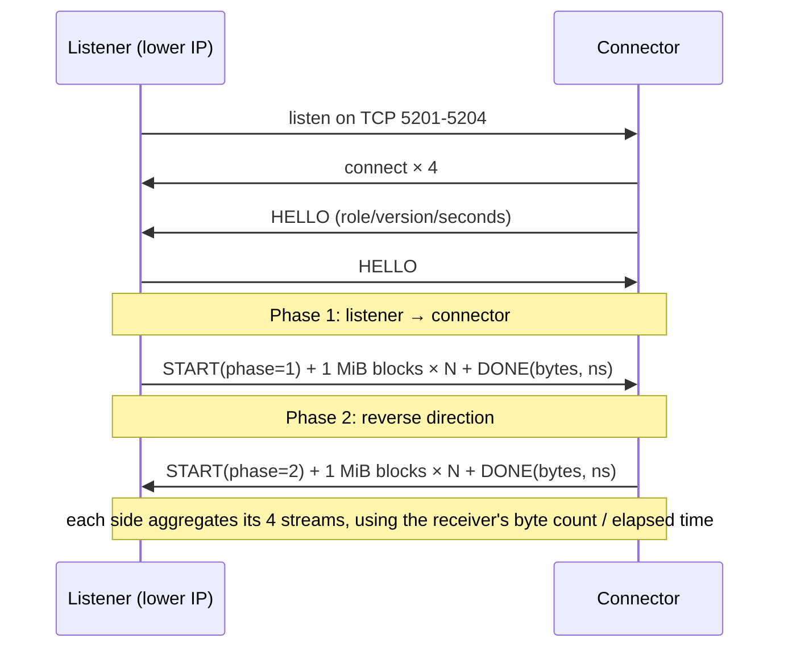

# LAN Speed Test

[中文](README.md) | English

**Tell in 30 seconds what a wireless link can actually carry.**

No server to deploy, no packet capture tool, no internet access, not a single byte of mobile data, no command line:
open the app on two devices, tap "Start" on each, and you get real bidirectional TCP throughput.

The Windows client is one `.exe`; the Android client is one `.apk`. Both compile the same core, so the two
sides always report the same numbers — which is the whole point if you want to use it to diagnose a link.

---

## When you need it

- Your new router says AX3000. How much of that do you actually get? Measure it instead of guessing with
  a broadband speed-test site.
- A phone lags while gaming in the bedroom: is the uplink too slow, or is that one bar of signal the problem?
  Measure again next to the router — the gap between the two runs is the cost of distance.
- 5 GHz vs 2.4 GHz: how big is the difference, and is it worth switching bands or adding a mesh node?
- You replaced a cable, moved the router, changed the channel. Did it help? Measure again, judge by numbers.
- Suspect your ISP is throttling? Prove the LAN can saturate gigabit first, then argue.

> This tool measures **real TCP throughput inside your LAN**. It never touches the internet, so it does not
> report your "plan speed" — it reports what these two devices can move right now. For diagnosing wireless
> problems, that is the number you want.

## Features

| Capability | Detail |
|---|---|
| Works out of the box | Double-click the exe / install the apk. No server, no account, no config file |
| No internet needed | LAN-only, zero mobile data, works on an isolated network |
| Bidirectional | A→B then B→A in one run, 10 s per direction — asymmetry is visible immediately |
| Parallel streams | 4 TCP connections (5201–5204) at once, escaping the single-connection window limit |
| Auto discovery | UDP 5310 broadcast + /24 unicast sweep; peer IP is filled in for you |
| No manual role picking | Listener vs. connector is decided by (local IP, device ID) — the two sides always agree |
| Nothing hits disk | 1 MiB blocks recycled in memory; no flash wear |
| Trustworthy numbers | Both sides show the same values, computed from the receiver's byte count and elapsed time |
| Optional logging | Off by default. When enabled: `lanspeed_log.txt` on PC, logcat on Android |
| Loopback self-test | `tests/ls_selftest.c` runs the full two-phase flow and asserts both sides match exactly |

## Verified

The current source (v1.0.0) has been tested on real hardware in the combinations below, with identical
numbers on both ends and no errors:

| Combination | Environment | Result |
|---|---|---|
| PC ↔ Android | Windows 10/11 ↔ Android 12 / Android 17, 5 GHz Wi-Fi | Pass |
| Android ↔ Android | Android 12 ↔ Android 17, same subnet | Pass |
| Core loopback self-test | Two sessions on one machine, pipeline on/off | Pass (0.000 Mbps delta) |
| PC ↔ PC | Same protocol, not separately tested | — |

## Download

Grab the file you need from [Releases](../../releases):

| Platform | File | Notes |
|---|---|---|
| Windows x64 | `LanSpeedTest-PC-v1.0.0.exe` | Single file, no installer, no DLLs |
| Android arm64 | `LanSpeedTest-Android-arm64-v1.0.0.apk` | minSdk 24, debug-signed, installs directly |

## Usage

1. Open the app on both devices, connected to the same Wi-Fi / router.
2. The peer IP is discovered and filled in automatically. If not, hit "Scan" or type the IPv4 address.
3. **Tap "Start" once on each device.** The app decides which side listens — you don't.
4. Two result lines: "local → peer" and "peer → local". Both devices show the same numbers.

> Keep both screens on while testing. Some ROMs (MIUI / ColorOS) freeze background processes or drop the
> connection when the screen turns off, which shows up as both sides reporting an error simultaneously.

## Reference results

| Link | Direction | Result |
|---|---|---|
| PC 192.168.5.12 ↔ phone 192.168.5.14 (Wi-Fi 5) | PC → phone | 339.94 Mbps / 10.61 s / 0.45 GB |
| same | phone → PC | 337.86 Mbps / 10.65 s / 0.45 GB |
| phone .14 (5 GHz) ↔ phone .13 (2.4 GHz) | .14 → .13 | 189.77 Mbps |
| same | .13 → .14 | 67.54 Mbps |

The large gap in the phone-to-phone case is expected: `.13` was on 2.4 GHz, so the air interface itself is
the bottleneck. Put both on 5 GHz and the two directions converge.

## Repository layout

```
.
├── core/                 # Platform-independent core, shared by both clients
│   ├── ls_core.c/h       # Session state machine: handshake → uplink → downlink → summary
│   └── ls_disc.c/h       # UDP discovery (broadcast + /24 unicast sweep)
├── pc/                   # Windows client (Win32 GUI, no third-party deps)
│   ├── pc_main.c
│   └── build.bat         # One-command MinGW-w64 build
├── android/              # Android client (Gradle + NDK, JNI over the same core)
│   ├── app/src/main/java/com/eagle/lanspeed/   # UI / foreground service
│   ├── app/src/main/jni/                       # JNI + Android.mk
│   └── gradlew.bat
├── tests/                # Core loopback self-test
├── docs/
│   ├── PROTOCOL.md       # Protocol and state machine details
│   └── BUILD.md          # Building both clients
└── .github/workflows/    # Tag push builds both artifacts and publishes a Release
```

Platform code lives in separate trees (`pc/`, `android/`); only the platform-independent `core/` is compiled
into both. Deliberately not split into two repositories: once the core forks, the two sides stop agreeing —
and a speed test that disagrees with itself is useless.

## How it works

Both devices open a UDP 5310 listener at startup and answer queries with their device ID and TCP port.
When a test starts, the two sides handshake to exchange role and duration, then:



Role assignment: compare both IPv4 addresses numerically (lower one listens); if equal, compare device ID
strings. The two sides compute opposite results, so "both listening, both waiting" cannot happen.

Data frames are pre-filled with fixed 0xA5 / 0x5A patterns. The receiver does not verify every byte — a
throughput test should not spend CPU on checksums — but the patterns make cross-talk and padding issues
obvious when debugging. Details: [docs/PROTOCOL.md](docs/PROTOCOL.md).

## Build

```bat
:: Windows client (requires gcc from MSYS2 mingw64 on PATH)
pc\build.bat

:: Core loopback self-test
tests\build_and_run.bat

:: Android (JDK 17+, Android SDK, NDK 27.2)
cd android
gradlew.bat assembleRelease
```

Dependencies, NDK path overrides and artifact naming: [docs/BUILD.md](docs/BUILD.md).

## Troubleshooting

| Symptom | Cause / fix |
|---|---|
| Peer not found | Different subnets; or Windows Firewall blocking UDP 5310 (allow "Private networks" on first run) |
| Stuck at "waiting for peer" | The other side never pressed Start; or its firewall blocks TCP 5201-5204 |
| Both sides error at once | Usually the peer's screen turned off and the OS froze the process; keep both screens on |
| Only one stream fails | Congestion starved a single stream. Since v1.0.0 it only affects itself; the UI reports "N/4 streams completed" with the results it got |
| Numbers look low | One side is on 2.4 GHz, or the router applies QoS / is repeating; retest on 5 GHz |
| Very different from a broadband speed test | Expected. This measures LAN TCP throughput, not internet speed — it usually lands closer to the physical ceiling |

## Version

`v1.0.0`, verified on Windows and Android hardware. See [CHANGELOG.md](CHANGELOG.md).

## License

[MIT](LICENSE)
