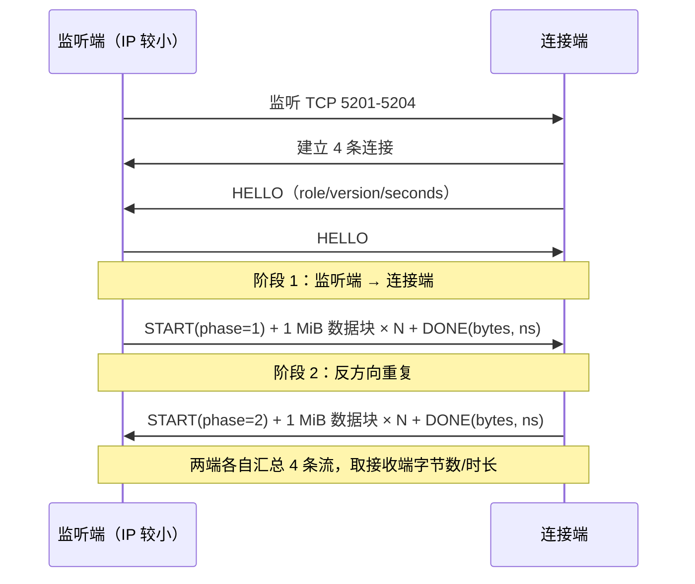

# 局域网测速 / LAN Speed Test

同一局域网内任意两台设备（PC ↔ 手机 / 手机 ↔ 手机 / PC ↔ PC）之间的双向 TCP 吞吐测试。
纯 C 实现，PC 端是单个 exe，安卓端是单个 APK，两端共用同一份核心代码，测出来的数字可以直接互相对照。

平台的代码分处 `pc/` 与 `android/` 两个独立目录，共享的协议与统计逻辑在 `core/`。

---

## 特性

| 项目 | 说明 |
|---|---|
| 双向测试 | 同一轮里先测 A→B，再测 B→A，单方向 10 秒 |
| 多流并行 | 4 条 TCP 连接（5201–5204）同时跑，绕开单连接窗口限制 |
| 自动发现 | UDP 5310 广播 + 本网段 /24 单播扫描，扫到就自动填对方 IP |
| 零手工配角色 | 按（本机 IP, 设备 ID）自动约定谁监听、谁连接 |
| 不落盘 | 内存 1 MiB 块循环发送，全程不写磁盘，不污染闪存 |
| 结果可信 | 两端显示同一组数字，以接收端实测字节数/时长为准 |
| 日志开关 | 默认关闭，勾选后 PC 写 `lanspeed_log.txt`，安卓写 logcat |
| 端到端自检 | `tests/ls_selftest.c` 本机回环跑完整两阶段流程，两端数值必须完全一致 |

## 下载

到 [Releases](../../releases) 下载对应文件：

| 平台 | 文件 | 说明 |
|---|---|---|
| Windows x64 | `LanSpeedTest-PC-v1.0.0.exe` | 单文件，双击即用，无需安装 / 无需 DLL |
| Android arm64 | `LanSpeedTest-Android-arm64-v1.0.0.apk` | minSdk 24，debug 签名，可直接安装 |

## 用法

1. 两台设备都打开程序，连同一个 Wi-Fi / 同一个路由器。
2. 程序会自动扫描并把对方 IP 填好；没扫到就点「扫描」，或手动输入 IPv4。
3. **两端各点一次「开始测速」**。谁监听谁连接由程序自己定，不用管。
4. 结果两行分别是「本机 → 对方」和「对方 → 本机」，两端数字一致。

> 测速期间请让两块屏幕都保持亮着。部分 ROM（MIUI / ColorOS）会在熄屏后冻结进程或断网，
> 表现为两端同时「出错」。

## 实测参考

| 链路 | 方向 | 结果 |
|---|---|---|
| PC 192.168.5.12 ↔ 手机 192.168.5.14（Wi-Fi 5） | PC → 手机 | 339.94 Mbps / 10.61 s / 0.45 GB |
| 同上 | 手机 → PC | 337.86 Mbps / 10.65 s / 0.45 GB |
| 手机 .14（5 GHz）↔ 手机 .13（2.4 GHz） | .14 → .13 | 189.77 Mbps |
| 同上 | .13 → .14 | 67.54 Mbps |

手机↔手机两个方向差这么多是正常的：`.13` 挂在 2.4 GHz，空口速率本身就是瓶颈。两台都连 5 GHz 会接近。

## 仓库结构

```
.
├── core/                 # 平台无关核心（协议、统计、发现），PC 与安卓共用
│   ├── ls_core.c/h       # 会话状态机：握手 → 上行 → 下行 → 汇总
│   └── ls_disc.c/h       # UDP 自动发现（广播 + /24 单播扫描）
├── pc/                   # Windows 端（Win32 GUI，无第三方依赖）
│   ├── pc_main.c
│   └── build.bat         # MinGW-w64 一键构建
├── android/              # 安卓端（Gradle + NDK，JNI 桥接同一份 core）
│   ├── app/src/main/java/com/eagle/lanspeed/   # UI / 前台服务
│   ├── app/src/main/jni/                       # JNI + Android.mk
│   └── gradlew.bat
├── tests/                # 核心回环自检
├── docs/
│   ├── PROTOCOL.md       # 协议与状态机细节
│   └── BUILD.md          # 从源码构建两端
└── .github/workflows/    # 打 tag 自动构建并发布 Release
```

PC 与安卓的**平台代码**彼此独立（`pc/`、`android/`），只有与平台无关的 `core/` 被两端同时编译。
故意不做成两个仓库：`core` 一旦分叉，两端数字就对不上了。

## 工作原理

两端启动后各自开一个 UDP 5310 监听，收到查询就回自己的设备 ID 和 TCP 端口。
开始测速时，两端先握手交换角色与时长，然后：



角色判定规则：比较两端 IPv4（数值比较，小者监听），IP 相同再比设备 ID 字符串。
这样两端各自算出的结论必然互斥，不会出现「两边都在监听」死等。

数据帧用 0xA5 / 0x5A 两种固定 pattern 填充，接收端不逐字节校验——测吞吐不做校验和，
但保留 pattern 便于排障时确认链路没有串包。细节见 [docs/PROTOCOL.md](docs/PROTOCOL.md)。

## 构建

```bat
:: Windows PC 端（需要 MSYS2 mingw64 的 gcc 在 PATH 里）
pc\build.bat

:: 核心回环自检
tests\build_and_run.bat

:: 安卓端（需要 JDK 17+、Android SDK、NDK 27.2）
cd android
gradlew.bat assembleRelease
```

完整依赖、NDK 路径覆盖方式、产物命名规则见 [docs/BUILD.md](docs/BUILD.md)。

## 故障排查

| 现象 | 原因 / 处理 |
|---|---|
| 扫不到对方 | 两台不在同一网段；或 Windows 防火墙拦了 UDP 5310（首次运行请允许「专用网络」） |
| 一直「等待对方连接」 | 对端没点开始；或对端防火墙拦了 TCP 5201-5204 |
| 两端同时「出错」 | 多半是对端熄屏被系统冻结（ColorOS 的 OplusHans、MIUI 省电）；保持亮屏重测 |
| 只有某一条流失败 | 空口拥塞把单条流饿死。v1.0.0 起该流只影响自己，界面显示「仅 N/4 条流完成」并给出其余流的实测值 |
| 数字明显偏低 | 一端挂在 2.4 GHz；或路由器做了 QoS / 中继；改用 5 GHz 直连对比 |
| 结果和 Speedtest 差很多 | 正常。本工具测的是**局域网内真实 TCP 吞吐**，不经过外网，通常更接近物理上限 |

## 版本

当前 `v1.0.0`。变更记录见 [CHANGELOG.md](CHANGELOG.md)。

## License

[MIT](LICENSE)
